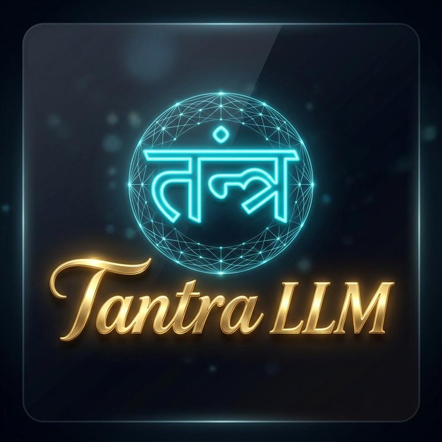
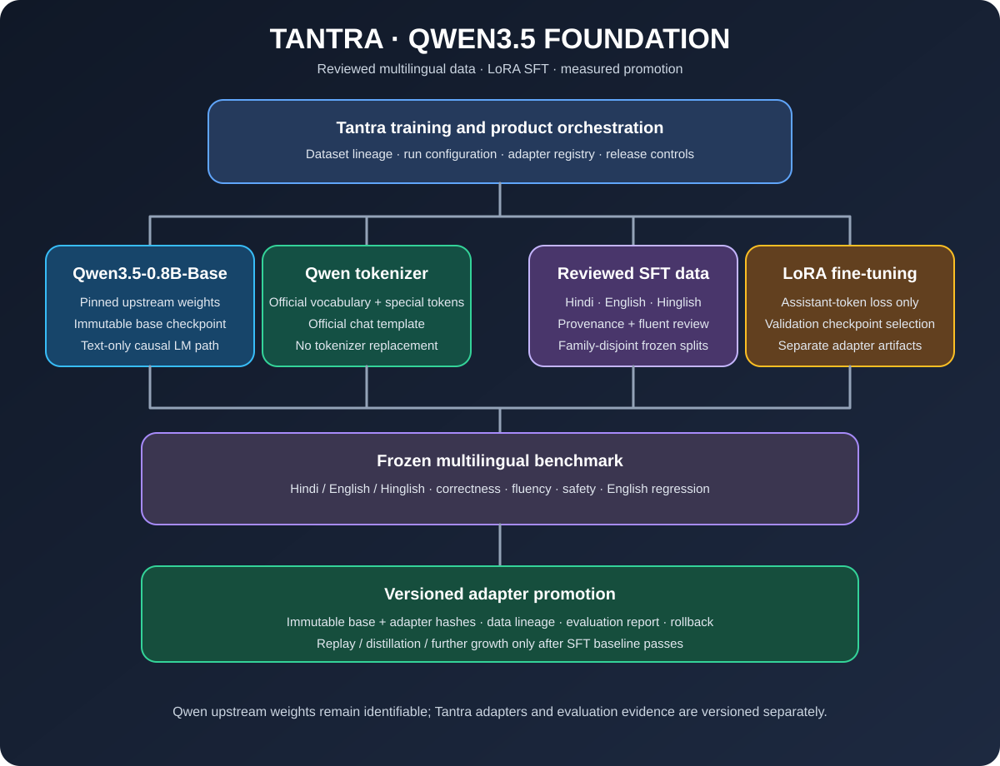

<div align="center">
  
  <h1>Tantra LLM</h1>
  <p><strong>A multilingual language-model project — built around measurable capability, not marketing claims.</strong></p>
  
</div>

<p align="center">
  <a href="https://www.python.org/downloads/"></a>
  <a href="https://pytorch.org/"></a>
  <a href="LICENSE"></a>
</p>

Tantra is an experimental language-model project using **Qwen3.5-0.8B-Base as its foundation checkpoint**. The base weights remain the upstream Qwen model; Tantra's work is the reviewed multilingual training data, fine-tuning recipe, adapters, evaluation and product integration. We do not claim that Qwen's pretrained weights were created by Tantra.

The repository retains a native Tantra Transformer as historical research code, but it is no longer the active foundation target. The active path is Qwen3.5 text-only supervised fine-tuning with LoRA, followed by controlled Hindi, English and Hinglish evaluation.

**Locked architecture decision (18 November 2026):**
- **Foundation:** `Qwen/Qwen3.5-0.8B-Base`, pinned to an immutable model revision.
- **First training stage:** reviewed multilingual SFT with LoRA; not pretraining from scratch.
- **Tokenizer/chat format:** preserve Qwen's official tokenizer and chat template.
- **Artifacts:** keep the base immutable; save each adapter candidate and its dataset/code/evaluation lineage separately.
- **Promotion:** require held-out capability improvement, safety checks and explicit English-regression measurement.

## Honest project status

<details open>
<summary><strong>What exists and has been verified</strong></summary>

- Python package, CLI entry points, native training/evaluation code and automated tests.
- The Qwen3.5-0.8B-Base LoRA SFT source pipeline and unit tests for JSONL provenance checks, family leakage and assistant-only label masking.
- The official Qwen3.5 tokenizer/chat-template path is preserved by the pipeline; the legacy 10,277-token native tokenizer is not used for Qwen.
- Historical native-model, SmolLM2 and Qwen3-1.7B experiments remain in the repository for provenance, but they are not the active foundation path.
- The Qwen3.5 model has not yet been downloaded or trained in the user's runtime; no Tantra adapter has been promoted.
- Latest main-branch CPU validation for the Qwen3.5 SFT scaffold passed: 235 tests passed, 1 skipped and 63 warnings; the existing small CPU training sample also completed. These tests do not download or train Qwen3.5 and do not establish language quality.

</details>

<details open>
<summary><strong>What is not established yet</strong></summary>

- No controlled SFT run has yet established a Hindi/Hinglish gain while preserving English quality.
- No approved Qwen-formatted multilingual train/validation/test corpus is currently certified ready for this pipeline.
- The earlier bilingual workflow failed its data-readiness gate because approved Hindi rows were insufficient for the required splits.
- No Qwen3.5 adapter has passed held-out evaluation or been promoted.

</details>

**Current priority:** prepare a provenance-backed Hindi-English-Hinglish SFT corpus, verify the Qwen3.5 environment and run a tiny LoRA smoke test. Then compare the untouched base and adapter on the same frozen held-out benchmark. Do not promote a model based on training loss or a successful smoke test alone.

## Architecture

<div align="center">
  
</div>

The active pipeline is:

1. Load the pinned Qwen3.5-0.8B-Base text model and its own tokenizer/chat template.
2. Fine-tune with reviewed conversation/instruction records using LoRA.
3. Select checkpoints using validation data only.
4. Evaluate base and adapter on identical held-out Hindi, English and Hinglish prompts.
5. Retain immutable adapter candidates with dataset, code and evaluation hashes.

The legacy native architecture and growth diagrams are historical research material, not the current foundation architecture.

## Quick start

Python 3.10+ is required. Install the package and test dependencies:

```bash
python -m pip install --upgrade pip
python -m pip install -e ".[test]"
python -m pytest Tests -q
```

Optional: inspect the legacy external-model gateway (not part of the active Qwen3.5 SFT pipeline):

```bash
python -m pip install -e ".[pretrained]"
python -m Tantra.pretrained_cli info
```

For LoRA training, install the fine-tuning extra:

```bash
python -m pip install -e ".[finetune,test]"
```

The Qwen3.5 fine-tuning extra requires PyTorch 2.7+, Transformers 5.23+ and PEFT 0.19.1+.

## Useful commands

```bash
# Legacy native research CLI
python -m Tantra --help
python -m Tantra chat
python -m Tantra ask "What is the capital of India?"

# CPU benchmark utility
python -m Tantra.bench_cpu --help

# Qwen3.5-0.8B LoRA SFT pipeline
python -m Tantra qwen35_finetune --help
python -m Tantra qwen35_eval --help

# Multilingual data intake and review
python -m Tantra.multilingual_data --help

# Full test suite
python -m pytest Tests -q
```

Named CLI entry points are dispatched by `Tantra/__main__.py`; see that file and `docs/HANDOFF.md` for the current command list. Do not assume commands from older README revisions still exist.

## Multilingual data: review before training

The intake pipeline is deliberately review-first:

1. Normalize source records to UTF-8 JSONL with stable record and conversation-family IDs.
2. Preserve source URL, revision, license and original record identity.
3. Run structural checks and quarantine malformed or suspicious rows.
4. Review correctness, naturalness, safety, privacy and license compatibility.
5. Require fluent-language review for Hindi and Hinglish approvals.
6. Split by conversation family, not individual messages or paraphrases.
7. Keep train, validation and test families disjoint and immutable.
8. Report Hindi, English and Hinglish separately. Never fill a language shortage by duplicating examples.

Start here:

- [Multilingual data pipeline](docs/MULTILINGUAL_DATA_PIPELINE.md)
- [Dataset specification](docs/DATASET_SPEC.md)
- [Hinglish dataset export](docs/HINGLISH_DATASET_EXPORT.md)
- [Aya dataset export](docs/AYA_DATASET_EXPORT.md)

## Qwen3.5 foundation and controlled fine-tuning

Qwen3.5-0.8B-Base is now the selected foundation checkpoint. The separate post-trained Qwen3.5-0.8B can be used as a reference model, not silently substituted for the Base checkpoint.

| Model | Role | Status |
|---|---|---|
| `Qwen/Qwen3.5-0.8B-Base` | Active fine-tuning foundation | Selected; pinned revision in the SFT pipeline |
| `Qwen/Qwen3.5-0.8B` | Post-trained reference comparison | Evaluation reference only |

The Qwen3.5 training pipeline is manually run by the developer. Do not trigger long model downloads or training jobs in ordinary CI.

Evaluation protocol:

- For optional external-model experiments, run the untouched reference checkpoint and each adapter candidate on identical held-out prompts; keep all artifacts separate from native Tantra lineage.
- Use the same prompt formatting, decoding settings, hardware and output budget.
- Report per-language correctness, instruction adherence, naturalness, factuality and safety with human review.
- Measure latency and throughput separately from quality.
- Report English regression explicitly.
- Keep test families sealed; never train on evaluation fixtures.

Read the [Qwen3.5 foundation and fine-tuning roadmap](docs/TANTRA_NATIVE_ARCHITECTURE_ROADMAP.md), [dataset specification](docs/DATASET_SPEC.md) and [benchmark protocol](docs/PRETRAINED_BENCHMARK_PROTOCOL.md).

## CI and experiments

- **Expansion and regression tests:** run for pull requests; one active run per PR is retained.
- **CPU validation:** runs on pushes to `main` and can be dispatched manually.
- **Pretrained checkpoint smoke:** runs only when relevant gateway, registry, fixture or dependency files change.
- **Bilingual 10M experiment:** manual only until approved Hindi data can satisfy the split-readiness gate.
- **Historical Qwen3 baseline:** manual-only comparison for the pinned 1.7B checkpoint; separate from the active Qwen3.5-0.8B SFT pipeline.

CI validates software and experiment mechanics. It does not certify language quality or production readiness.

## Repository layout

```text
Tantra-LLM/
├── Assets/       # Banners, logo and architecture diagrams
├── Model/        # Tokenizer artifacts; no trained native checkpoint in the clean baseline
├── Tantra/       # Model, training, data, gateway, adaptation and evaluation code
├── Tests/        # Unit, integration and regression tests
├── configs/      # Model registry, experiment manifests and research configuration
├── docs/         # Dataset policy, evaluation protocols, handoff and research plans
├── examples/     # Small, reproducible training experiments
└── pyproject.toml
```

Generated datasets, checkpoints, adapters and run outputs belong in local ignored paths such as `Datasets/`, `checkpoints/` and `runs/`. Check the relevant data and model licenses before using or redistributing any artifact.

## Developer handoff

Before changing training, data or model lifecycle code, read:

- [AGENTS.md](AGENTS.md)
- [Developer handoff](docs/HANDOFF.md)
- [Dataset specification](docs/DATASET_SPEC.md)
- [Native architecture roadmap](docs/TANTRA_NATIVE_ARCHITECTURE_ROADMAP.md)

## License

Tantra-LLM source code is licensed under the MIT License. Third-party model weights and datasets retain their own licenses and terms. See [LICENSE](LICENSE).
