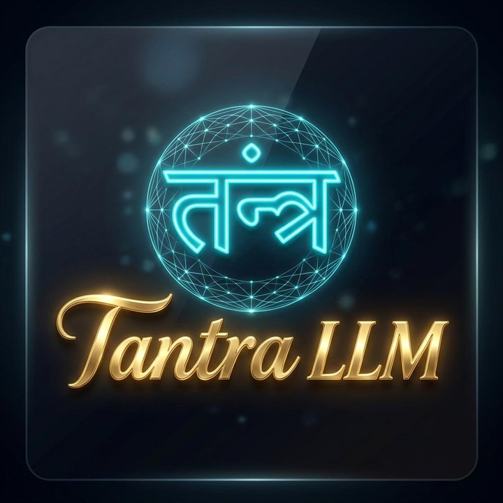
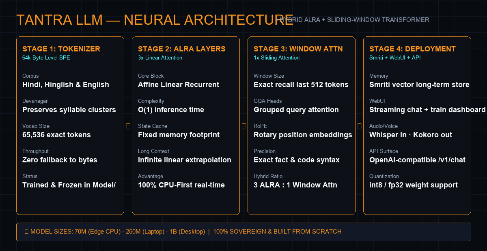

<!-- Full-width hero banner -->
<div align="center">
  
</div>

<div align="center">
  <h1>
    
  </h1>
</div>

<p align="center">
  <em><strong>αññαñ¿αÑìαññαÑìαñ░</strong> (Sanskrit) — An instrument that weaves threads of knowledge
  <strong>αññαñéαññαÑìαñ░</strong> (Hindi) — System, mechanism, governance</em>
</p>

<p align="center">
  <a href="https://www.python.org/downloads/"></a>
  <a href="https://pytorch.org/"></a>
  <a href="LICENSE"></a>
  <a href="#"></a>
  <a href="#"></a>
  <a href="#"></a>
</p>

<div align="center">
  
</div>

---

**Tantra** is a **CPU-first language model built from scratch**: a small shared base
transformer with independent LoRA domain experts, an n-gram/embedding router, a
decoupled relational knowledge engine, and a think-check-search reasoning loop —
training and inference that fit on a laptop CPU.

- **Canonical Model Directory**: `Model/` (holds tokenizer artifacts; base weights,
  experts, and router land here when trained — nothing is deployed in this tree yet).
- **10k Bilingual Tokenizer**: ByteLevel BPE with 10,277 vocabulary entries that
  keeps Devanagari conjuncts and matras intact without Unicode codepoint shattering.
- **Sparse Mixture-of-Adapters**: only the router-selected experts run;
  `TantraEngine` loads adapters on demand (LRU, capped), so extra experts cost
  disk, not RAM.
- **Knowledge Engine + Reasoning**: integer triple store plus BM25/dense vector
  indexes for retrieval, and the `reasoning.py` draft/check/search/fix loop for
  verified answers.

> **State**: after the 2026-11 repository reset this tree is a verified clean
> source baseline — full test suite green (126 passed including an end-to-end
> tiny-model build) with no trained weights. Train your own with the Quickstart
> below. Developers: read [AGENTS.md](AGENTS.md) and [docs/HANDOFF.md](docs/HANDOFF.md) first.

---

## Architecture Overview

<div align="center">
  
</div>

```
   User Query (any language)
                    │
                    ▼
       ┌──────────────────────┐
       │   Fast N-Gram Router │  Unicode-aware word & char n-grams
       └──────────────┬───────┘
                     │  active = [("gk_indic", 0.8), ("greeting", 0.2)]
                     ▼
┌────────────────────────────────────────────────────────────────────────┐
│                    Shared Base Transformer                             │
│      28.8M-class presets ┬ RoPE ┬ GQA ┬ SwiGLU ┬ RMSNorm ┬ Tied Head │
│                                                                          │
│      Dynamic LoRA Modules on Q, V, O, and Down-projections:             │
│             y = base(x) + Σ (x @ Aₙ @ Bₙ) · scale · wₙ                   │
│                      └ only ACTIVE experts run ─┘                        │
└───────────────────────────────┬────────────────────────────────────────┘
                                │
                                ▼
┌────────────────────────────────────────────────────────────────────────┐
│               Tantra Decoupled Knowledge Engine                        │
│      1. DNA Integer TripleStore (O(1) relational graph)               │
│      2. Hybrid Inverted BM25 + Dense Vector Index                     │
│      3. Self-Learning Verifier (auto-curates offline facts)           │
└────────────────────────────────────────────────────────────────────────┘
```

---

## Key Design Principles

1. **The model is the product**: one shared base, many tiny experts — the router
   picks top-k per request, so forward-pass cost does not grow with the number
   of experts, and function-preserving `grow` deepens the base without changing
   the output shape.
2. **Decoupled High-Density Memory**: the transformer is not expected to memorize
   static facts. Encyclopedic facts live in an integer-indexed relational triple
   store with BM25 + dense retrieval, freeing the base for language structure.
3. **Bilingual, Devanagari-true tokenization**: ByteLevel BPE (10,277 entries,
   64K extension designed in `docs/`) preserves Indic script integrity; presets
   scale from a ~6.5M smoke model (`--preset tiny`) through ~1B.
4. **Verified answers, not vibes**: the reasoning loop drafts N candidates, runs
   exact arithmetic checks and knowledge-index comparisons, then searches before
   answering; probes and benchmarks are recorded, never assumed.

---

## Directory Structure

```
Tantra-LLM/
├─ Assets/                 # Official banners, logos, and architecture diagrams
├─ Datasets/               # Local (gitignored) data: public corpus, review bundles
├─ Model/                  # Canonical model directory (currently tokenizer artifacts)
├─ Tantra/                 # Flat package: model, training, data, review, inference
│   ├─ train.py            # Trainer, checkpoints, TantraModel, PEER, workbench
│   ├─ pretrain.py         # Public sources, corpus prep, base pilot
│   ├─ tokenizer.py        # Tokenizer candidates and vocabulary migration
│   ├─ main.py             # python -m Tantra CLI (seed..chat)
│   ├─ evaluate.py         # Reply/router evaluation
│   ├─ evaluate_conversation.py  # Memory store and indexes
│   ├─ dashboard.py        # Bulk review, review sheets, live dashboard
│   ├─ conversation_train.py     # Seed writers, conversation training
│   └─ reasoning.py        # Think -> Check -> Verify -> Learn reasoning loop
├─ Tests/                  # 4 grouped test suites (126 checks)
├─ docs/                   # Specifications, expert cards (docs/experts/), data locks
├─ clean_workspace.ps1     # Safe local-artifact cleanup
└─ pyproject.toml          # Project configuration and metadata
```

---

## Quickstart & CLI

### 1. Train a talking model in minutes (CPU)
```bash
python -m Tantra seed                                # curated stage-1 data
python -m Tantra stage1 --preset tiny                # tokenizer + base + experts + router
python -m Tantra chat                                # talk to it
```
`stage1`/`base`/`expert` write into `Model/`; use `--model-dir runs/pilot` to keep
your shipped weights untouched.

### 2. Interactive Chat & Questions
```bash
python -m Tantra ask "What is the capital of India?"
python -m Tantra chat
python -m Tantra chat --int8        # fast CPU inference (INT8 dynamic quantization)
```

### 3. Bigger bases & experts
```bash
python -m Tantra base --preset small --steps 1500
python -m Tantra expert greeting --steps 300
python -m Tantra router
python -m Tantra grow --layers 2                    # deepen the base, output unchanged
```

### 4. Benchmarks, review and tests
```bash
pytest -m "not slow"                          # full suite (slow end-to-end: pytest -m slow)
python -m Tantra.bench_cpu --tag my-base      # serving-path latency/RSS benchmark
python -m Tantra workbench_cli status         # dataset/expert inventory
python -m Tantra review_cli sample --queue Q --n 50   # human review workflow
```

---

## License

This project is licensed under the MIT License — see the [LICENSE](LICENSE) file for details.
