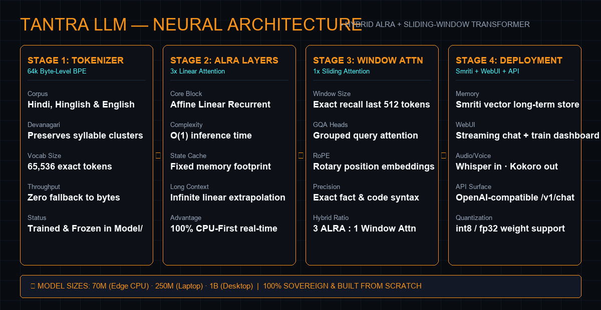

<div align="center">
  
  <h1>Tantra LLM</h1>
  <p><strong>A Hindi-first, multilingual AI research platform — built around measurable capability, not marketing claims.</strong></p>
  
</div>

<p align="center">
  <a href="https://www.python.org/downloads/"></a>
  <a href="https://pytorch.org/"></a>
  <a href="LICENSE"></a>
</p>

Tantra is an experimental AI platform. The repository contains two related tracks:

1. **Native research backend** — a small Transformer, tokenizer, training/evaluation code, routing and expert/adaptation experiments.
2. **Pretrained-model engineering** — a local model gateway, model registry, LoRA adaptation, replay, residual-branch experiments, benchmark reports and candidate lifecycle controls.

The platform direction is pretrained-first: use a capable foundation model, adapt it with reviewed data, evaluate it against a frozen benchmark, and promote a candidate only when measured gains justify it. Tantra is the orchestration and product layer; it does not make every upstream model its own foundation model.

## Honest project status

<details open>
<summary><strong>What exists and has been verified</strong></summary>

- Python package, CLI entry points, native training/evaluation code and automated tests.
- A tokenizer artifact in `Model/`; the repository does not contain a ready-to-use trained native model checkpoint.
- Pretrained gateway and registry with pinned model revisions.
- A pinned **SmolLM2-360M-Instruct** checkpoint integration path used for CPU LoRA/replay and residual-branch smoke tests. This is an engineering test, not evidence of Hindi capability.
- **Qwen3-1.7B** is registered as a multilingual evaluation candidate. Its manual workflow runs a small engineering fixture; it has not been selected or promoted as Tantra's foundation model.
- The latest main-branch CPU and expansion test workflows passed on 18 November 2026: the expansion suite reported 230 passed and 1 skipped. Passing software tests do not establish language quality.

</details>

<details open>
<summary><strong>What is not established yet</strong></summary>

- No frontier-scale model has been trained from scratch by this repository.
- No production-ready Hindi-English-Hinglish foundation model has been demonstrated.
- No controlled LoRA result has yet established a Hindi/Hinglish gain while preserving English quality.
- The 64K tokenizer is a candidate plan, not the active tokenizer. The current model vocabulary is 10,277; migration requires embedding expansion, training and held-out validation.
- The current multilingual intake documentation records a shortage of approved Hindi and Hinglish conversation rows. The automated 10M bilingual experiment currently fails its honest data-readiness gate because it cannot form the required Hindi train/validation/test splits.
- Architecture growth, expert inheritance, distillation and large model-family tiers are research directions unless a specific test or report proves the implementation.

</details>

**Current priority:** build a provenance-backed Hindi-English-Hinglish data pipeline, secure fluent review, freeze family-disjoint splits, compare stronger multilingual foundation models, run controlled LoRA experiments, and report per-language quality plus English regression. Do not promote a model based on training loss, parameter count, latency or a successful smoke test alone.

## Architecture

<div align="center">
  
</div>

At a high level:

- **Model gateway and registry** keep model identity, source revision, architecture and license metadata explicit.
- **Adaptation** supports LoRA training with replay and experimental residual-branch growth for compatible architectures.
- **Data intake** preserves source provenance, revision, license, record IDs and review decisions. Intake checks are triage, not proof of fluency or correctness.
- **Evaluation** runs the same frozen prompts against base and candidate models and records outputs, latency and provenance.
- **Lifecycle controls** keep candidate promotion separate from training and require evaluation evidence.

The native implementation remains available as a research baseline:

<div align="center">
  
</div>

The native backend is a small research model. It should not be described as equivalent to a modern pretrained foundation model.

## Quick start

Python 3.10+ is required. Install the package and test dependencies:

```bash
python -m pip install --upgrade pip
python -m pip install -e ".[test]"
python -m pytest Tests -q
```

For pretrained-model integration:

```bash
python -m pip install -e ".[pretrained]"
python -m Tantra.pretrained_cli info
```

For LoRA training, install the fine-tuning extra:

```bash
python -m pip install -e ".[finetune,test]"
```

The fine-tuning extra requires Transformers 4.51 or newer (below 5), matching the Qwen3 architecture support floor.

## Useful commands

```bash
# Main native CLI
python -m Tantra --help
python -m Tantra chat
python -m Tantra ask "What is the capital of India?"

# CPU benchmark utility
python -m Tantra.bench_cpu --help

# Pretrained gateway
python -m Tantra.pretrained_cli info
python -m Tantra.pretrained_cli --help

# Multilingual data intake and review
python -m Tantra.multilingual_data --help

# Full test suite
python -m pytest Tests -q
```

Named CLI entry points are dispatched by `Tantra/__main__.py`; see that file and `docs/HANDOFF.md` for the current command list. Do not assume commands from older README revisions still exist.

## Multilingual data: review before training

The intake pipeline is deliberately review-first:

1. Normalize source records to UTF-8 JSONL with stable record and conversation-family IDs.
2. Preserve source URL, revision, license and original record identity.
3. Run structural checks and quarantine malformed or suspicious rows.
4. Review correctness, naturalness, safety, privacy and license compatibility.
5. Require fluent-language review for Hindi and Hinglish approvals.
6. Split by conversation family, not individual messages or paraphrases.
7. Keep train, validation and test families disjoint and immutable.
8. Report Hindi, English and Hinglish separately. Never fill a language shortage by duplicating examples.

Start here:

- [Multilingual data pipeline](docs/MULTILINGUAL_DATA_PIPELINE.md)
- [Dataset specification](docs/DATASET_SPEC.md)
- [Hinglish dataset export](docs/HINGLISH_DATASET_EXPORT.md)
- [Aya dataset export](docs/AYA_DATASET_EXPORT.md)

## Foundation-model evaluation

The current shortlist is an evaluation queue, not a winner announcement:

| Model | Role in this repository | Status |
|---|---|---|
| HuggingFaceTB/SmolLM2-360M-Instruct | Small integration and adaptation smoke baseline | Pinned; English-first; not the target foundation |
| Qwen/Qwen3-1.7B | Primary multilingual baseline candidate | Pinned; not promoted |

The Qwen3 workflow is manually dispatched because downloading and evaluating a 1.7B checkpoint on CPU is a deliberate experiment, not a per-commit test.

Evaluation protocol:

- Run the untouched base and each LoRA candidate on identical held-out prompts.
- Use the same prompt formatting, decoding settings, hardware and output budget.
- Report per-language correctness, instruction adherence, naturalness, factuality and safety with human review.
- Measure latency and throughput separately from quality.
- Report English regression explicitly.
- Keep test families sealed; never train on evaluation fixtures.

Read [the foundation-model shortlist](docs/FOUNDATION_MODEL_EVALUATION_SHORTLIST.md) and [the benchmark protocol](docs/PRETRAINED_BENCHMARK_PROTOCOL.md).

## CI and experiments

- **Expansion and regression tests:** run for pull requests; one active run per PR is retained.
- **CPU validation:** runs on pushes to `main` and can be dispatched manually.
- **Pretrained checkpoint smoke:** runs only when relevant gateway, registry, fixture or dependency files change.
- **Bilingual 10M experiment:** manual only until approved Hindi data can satisfy the split-readiness gate.
- **Qwen3 baseline:** manual only; downloads and evaluates the pinned 1.7B checkpoint.

CI validates software and experiment mechanics. It does not certify language quality or production readiness.

## Repository layout

```text
Tantra-LLM/
├── Assets/       # Banners, logo and architecture diagrams
├── Model/        # Tokenizer artifacts; no trained native checkpoint in the clean baseline
├── Tantra/       # Model, training, data, gateway, adaptation and evaluation code
├── Tests/        # Unit, integration and regression tests
├── configs/      # Model registry, experiment manifests and research configuration
├── docs/         # Dataset policy, evaluation protocols, handoff and research plans
├── examples/     # Small, reproducible training experiments
└── pyproject.toml
```

Generated datasets, checkpoints, adapters and run outputs belong in local ignored paths such as `Datasets/`, `checkpoints/` and `runs/`. Check the relevant data and model licenses before using or redistributing any artifact.

## Developer handoff

Before changing training, data or model lifecycle code, read:

- [AGENTS.md](AGENTS.md)
- [Developer handoff](docs/HANDOFF.md)
- [Dataset specification](docs/DATASET_SPEC.md)
- [Pretrained expansion roadmap](docs/TANTRA_PRETRAINED_EXPANSION_ROADMAP.md)

## License

Tantra-LLM source code is licensed under the MIT License. Third-party model weights and datasets retain their own licenses and terms. See [LICENSE](LICENSE).
