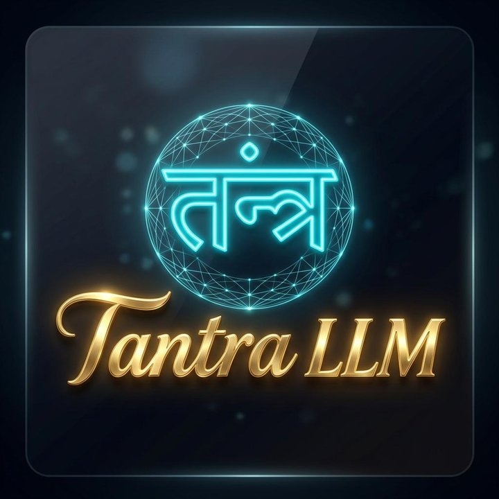
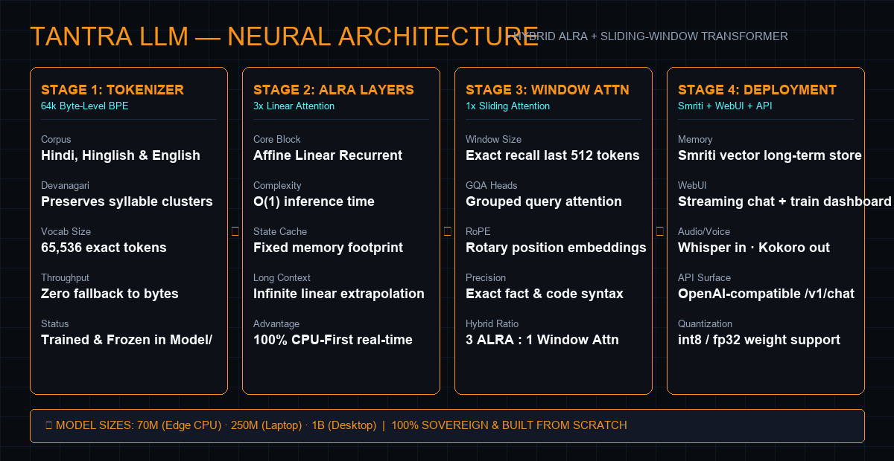

<!-- Full-width hero banner -->
<div align="center">
  
</div>

<div align="center">
  <h1>
    
  </h1>
</div>

<p align="center">
  <em><strong>तन्त्र</strong> (Sanskrit) — An instrument that weaves threads of knowledge ·
  <strong>तंत्र</strong> (Hindi) — System, mechanism, governance</em>
</p>

<p align="center">
  <a href="https://www.python.org/downloads/"></a>
  <a href="https://pytorch.org/"></a>
  <a href="LICENSE"></a>
  <a href="#"></a>
  <a href="#"></a>
  <a href="#"></a>
</p>

<div align="center">
  
</div>

---

**Tantra** is a **CPU-first, bilingual (Hindi + Sanskrit + English) language model built from scratch**.
It combines a 28.8M parameter base transformer with independent LoRA domain experts, an n-gram/embedding router, and a decoupled high-density DNA relational knowledge engine.

- **Canonical Model Directory**: `Model/` (28.8M base parameters, $d=512$, 8 layers, 8 heads, 4 KV heads, GQA, RoPE, SwiGLU, RMSNorm).
- **10k Bilingual Tokenizer**: ByteLevel BPE with 10,277 vocabulary, reducing Indic token fragmentation by **3x** (from 57 tokens down to 19 tokens for typical sentences).
- **DNA Relational Knowledge Engine**: encyclopedic facts plus $(S, P, O)$ relational triples for fast CPU retrieval (the earlier 8,175-fact / 0.05 ms figures have no recorded run in this repo and are unverified).
- **CPU Inference**: measured on a 4-core i3 with the 64K base: ~41 tok/s FP32, ~44 tok/s INT8, first token ~0.03 s, ~430 MB RSS (`scripts/bench_cpu.py`, `runs/bench/`).

### 📍 Current status (October 2026)

| Area | State |
| --- | --- |
| Deployed `Model/` | 28.8M base, 10K tokenizer, 20 LoRA adapters; direct replies are often incorrect or garbled |
| New 64K candidate | 57.2M base, 65,536-token tokenizer, continued pretraining on Hindi/English Wikipedia (separate from `Model/`, not deployed) |
| 19M-token stage | **Complete** (4,639 updates). Final validation: Hindi loss 2.64 / top-1 43%, English loss 5.70 / top-1 22% (stage start: 3.95 / 7.05) |
| Conversation | **Not chat-ready.** Greeting/identity probe answers are still incoherent; pretraining alone does not teach dialogue |
| GPU training | `TANTRA_DEVICE=cuda` runs the same resumable trainer on Kaggle (~3,500 tok/s vs ~325 tok/s on a 4-core CPU); see `scripts/kaggle/` |
| Conversation data | 129 English drafts + Hindi/Hinglish writing sheet await human review; `python -m Tantra.data.review_sheets` imports approved rows |
| Expert adapters | Trained on the old base; must be retrained against the 64K base before use |

Developers and coding models: read [AGENTS.md](AGENTS.md) and [docs/HANDOFF.md](docs/HANDOFF.md) first.

---

## Architecture Overview

<div align="center">
  
</div>

```
   User Query (English / Hindi / Sanskrit)
                    │
                    ▼
       ┌────────────────────────┐
       │   Fast N-Gram Router   │  Unicode-aware word & char n-grams
       └────────────┬───────────┘
                    │  active = [("gk_indic", 0.8), ("greeting", 0.2)]
                    ▼
┌─────────────────────────────────────────────────────────────────┐
│                    Shared Base Transformer                      │
│      28.8M params · RoPE · GQA · SwiGLU · RMSNorm · Tied Head   │
│                                                                 │
│      Dynamic LoRA Modules on Q, V, O, and Down-projections:     │
│             y = base(x) + Σ (x @ Aₙ @ Bₙ) · scale · wₙ          │
│                      └ only ACTIVE experts run ─┘               │
└───────────────────────────────┬─────────────────────────────────┘
                                │
                                ▼
┌─────────────────────────────────────────────────────────────────┐
│               Tantra Decoupled Knowledge Engine                 │
│      1. DNA Integer TripleStore (0.05ms O(1) relational graph)  │
│      2. Hybrid Inverted BM25 + Dense SIMD 64-dim Vector Index   │
│      3. Self-Learning Verifier (auto-curates offline facts)      │
└─────────────────────────────────────────────────────────────────┘
```

---

## Key Design Principles

1. **Sparse Mixture-of-Adapters (MoA)**: Only the router-selected experts run. `TantraEngine` loads expert adapters on demand (at most 8 resident by default), so extra experts cost disk, not RAM: measured on a 4-core i3 with the 64K base, 160 synthetic rank-8 experts kept peak RSS at 447 MB (lazy) vs 623 MB (eager), at about 40 tok/s either way (`scripts/bench_cpu.py`, `runs/bench/`).
2. **Decoupled High-Density Memory**: Large language models waste parameters memorizing static facts. Tantra stores thousands of encyclopedic facts in an integer-indexed DNA relational triple store (`Model/memory.pt` is under 2 MB), freeing the transformer to focus on language structure and reasoning.
3. **Indic-First Tokenization**: ByteLevel BPE with 10,277 tokens preserves Devanagari conjuncts, matras, and Sanskrit roots without Unicode codepoint shattering.
4. **Function-Preserving Growth**: `grow_depth()` inserts layers with zeroed output projections, making depth expansion bit-identical and seamlessly resumable on the same laptop.

---

## Directory Structure

```
Tantra-LLM/
├── Assets/                 # Official banners, logos, and architecture diagrams
├── Datasets/
│   ├── curated/            # Curated domain dialogs (knowledge, conversation, reasoning)
│   ├── experts/knowledge/  # 24 encyclopedic knowledge domains (physics, medicine, law, etc.)
│   └── general/            # Plain-text pretraining corpus
├── Model/                  # Canonical unified model directory
│   ├── base.pt             # 28.8M base model checkpoint
│   ├── memory.pt           # 1.87 MB packed high-density knowledge memory
│   ├── tokenizer.json      # 10,277 bilingual BPE tokenizer
│   ├── router_ngram.pt     # Fast Unicode n-gram router
│   └── experts/            # 20 independent LoRA expert weights
├── Tantra/
│   ├── config/             # Model presets, hyperparameters, and taxonomy
│   ├── data/               # Expert dataset loaders and chat encoders
│   ├── inference/          # Inference engine, KV-cache, and streaming
│   ├── memory/             # Dense SIMD index, inverted BM25, and DNA TripleStore
│   ├── model/              # TantraModel, LoRALinear, RoPE, and Router
│   ├── reasoning.py        # Think -> Check -> Verify -> Learn reasoning loop
│   ├── tokenizer.py        # Tokenizer wrapper and chat formatting
│   └── training/           # Training pipeline, cosine LR scheduler, and growth
├── tests/                  # Unit and integration test suite (29 tests)
├── pyproject.toml          # Project configuration and metadata
└── train_small_bilingual.py # Base model pretraining & adaptation script
```

---

## Quickstart & CLI

### 1. Interactive Chat & Questions
```bash
# Ask a question using the full Reasoning & Knowledge loop:
python -m Tantra ask "What is the capital of India?"
python -m Tantra ask "भारत की राजधानी क्या है?"
python -m Tantra ask "Who wrote Ashtadhyayi?"

# Interactive chat:
python -m Tantra chat

# Fast CPU inference with INT8 dynamic quantization:
python -m Tantra chat --int8
```

### 2. Knowledge Memory Ingestion
Pack encyclopedic knowledge across 24 domains and DNA relational triples into `Model/memory.pt`:
```bash
python build_knowledge_memory.py
```

### 3. Training
Train or adapt the base model on CPU:
```bash
# Launch full 1000-step bilingual training pipeline:
python train_small_bilingual.py

# Train a single expert in complete isolation:
python -m Tantra expert greeting --steps 300
```

### 4. Running Benchmarks & Tests
```bash
# Real tokens/second on your CPU:
python bench_test.py

# Run test suite:
pytest
```

---

## License

This project is licensed under the MIT License — see the [LICENSE](LICENSE) file for details.
