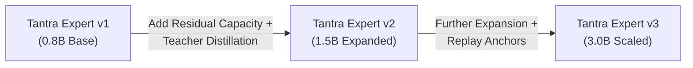

# Tantra Upgradeable Architecture and Roadmap: Evolution Without Restarting

**Status:** CONFIRMED & ACTIVE ARCHITECTURAL DIRECTIVE — 18 November 2026  
**Guiding Thesis:** Tantra must be **upgradeable, not restartable**. We cannot afford to rebuild the entire system whenever we improve the architecture or expand an expert from 0.8B to 2B or 3B parameters.

---

## 1. Tantra Identity: Independent Expandable Intelligence

Tantra is an independent expandable intelligence system. It is **not** a renamed clone of any third-party model.

Tantra maintains its own:
- **Model Identity & Behavior Policy:** Controlled system prompt, personality, ethics, and instruction alignment.
- **Neural Expert Interface & Registry:** Universal hidden-state contract enabling interchangeable, versioned expert blocks.
- **Hierarchical Routing Architecture:** Multi-tier semantic and token-level routing.
- **Training & Distillation Pipeline:** Provable provenance, frozen family-disjoint splits, prompt loss masking.
- **Knowledge & Memory Architecture:** Parametric weights, external memory/vector store, and operational tools.
- **Artifact Lineage:** Immutable commit hashes, split hashes, and adapter manifests.

When an established open-weights foundation checkpoint (such as `Qwen3.5-0.8B-Base`) is leveraged as an initial base, it serves as the foundational substrate and initial teacher. Tantra's true intelligence is built into its adapter lineage, modular MoE blocks, routing decisions, reviewed multilingual data, and upgrade mechanics.

---

## 2. Stop Treating 0.8B, 1.5B, and 3B as Disposable Models

Instead of discarding smaller models when larger ones are built, treat them as continuous versions of an evolving expert family:



The 0.8B model is never disposable:
- It acts as the immutable **teacher** for distillation.
- It serves as a **fallback** when latency or energy budgets are constrained.
- It provides a **regression baseline** ensuring no previous capability is lost.

---

## 3. Six Techniques to Avoid Retraining Everything

| Technique | Operational Definition | Role in Tantra |
| :--- | :--- | :--- |
| **Progressive Network Growth** | Adds parallel layers or expert blocks to existing models | Preserves pre-existing weights byte-for-byte |
| **Knowledge Distillation** | Teaches expanded branches to emulate parent representations | Preserves learned capabilities without quality collapse |
| **Adapter / LoRA Training** | Restricts gradient updates to low-rank matrices ($r=8$) | Drastically reduces compute and storage costs |
| **Continual Learning with Replay**| Interleaves historical anchor examples with new curriculum | Prevents catastrophic forgetting |
| **Modular Expert Replacement** | Upgrades or hot-swaps a single domain expert | Localizes improvements without whole-system retraining |
| **Versioned External Contracts** | Keeps module input/output signatures backward-compatible | Eliminates system-wide code rewrites |

---

## 4. Expandable Residual Experts: The Growth Mechanism

Instead of mutating or widening internal weights in place, Tantra grows capacity via **Expandable Residual Branches**:

$$y = E_{\text{existing}}(x) + g(x) \cdot E_{\text{new}}(x)$$

Where:
- $E_{\text{existing}}$ is the trained, frozen expert branch (e.g. 0.8B).
- $E_{\text{new}}$ is the newly attached neural capacity (e.g. +0.7B, +1.4B, or +2.2B).
- $g(x)$ is a learnable scalar or vector gate initialized at $0.0$ (or small $\epsilon$).
- Both branches project into the identical shared hidden dimension.

Because $g(x)$ starts at zero, the model's forward pass at initialization is numerically identical to the parent. Training optimizes the new branch on new tasks while distillation from the frozen branch prevents forgetting.

```
Input hidden state x
    ├───> [Frozen 0.8B Expert Branch] ───────────────> Output A ────┐
    │                                                               ├───> y = Output A + (Gate * Output B)
    └───> [Trainable Residual Branch (+2.2B)] ──> Gate * Output B ──┘
```

---

## 5. Incremental Modular MoE & The 1/10 Activation Horizon

To scale toward **1 Trillion Parameters** without requiring massive high-performance computing clusters per token:
1. **Capacity via MoE:** Add capacity in modular 0.8B units across layers rather than densifying the core.
2. **Sparse Activation (1/10 Target):** At any given token, only 10% (or eventually 1–5%) of total parameters are active.
3. **Hierarchical Routing Architecture:**
   - **Level 1 (Global Task Router):** Identifies domain, language (Hindi/English/Hinglish), and intent.
   - **Level 2 (Domain Group Router):** Dispatches to Reasoning, Coding, Math, Language, or Tool groups.
   - **Level 3 (Neural Expert Selection):** Chooses Top-$k$ compatible expert blocks per token within the layer.

---

## 6. Prototype Roadmap & Verified Status

The 7-milestone roadmap to prove evolutionary growth before hyper-scale deployment:

| Milestone | Deliverable | Pass Condition | Verified Machine Status |
| :---: | :--- | :--- | :---: |
| **M1** | **Foundation & Tokenizer** | Checkpoint load, vocab verification, generation | **COMPLETED & VERIFIED** (Qwen3.5-0.8B-Base loaded, Hindi generation verified) |
| **M2** | **Compatible Neural Experts** | Low-rank adapter mechanics, prompt loss masking | **COMPLETED & VERIFIED** (LoRA SFT pipeline trained, saved & reloaded) |
| **M3** | **Interactive & Eval Tooling** | Interactive terminal, eval harness, preflight | **COMPLETED & VERIFIED** (`qwen35_preflight`, `qwen35_eval`, `qwen35_chat`) |
| **M4** | **Multilingual Data Splits** | Frozen family-disjoint train/val/test, data-ready | **IN PROGRESS** (Requires reviewed Hindi & Hinglish split ingestion) |
| **M5** | **Controlled Benchmark** | Independent eval, English regression check | **READY TO RUN** (Harness active; waiting on M4 data gate) |
| **M6** | **Residual Branch Expansion** | $y = E(x) + g(x)E_{\text{new}}(x)$ gate init = 0 | **DESIGNED & READY FOR CODE PROTOTYPE** |
| **M7** | **Distillation & Replay** | Preserve parent capability during capacity boost | **PLANNED** |

---

## 7. Operational Guide: How to Talk & Run Tantra

### 7.1 How to Talk to Tantra
You can converse with Tantra interactively or pass single prompts:

```bash
# 1. Interactive terminal session (Base model):
python -m Tantra qwen35_chat

# 2. Interactive terminal session with a trained LoRA adapter:
python -m Tantra qwen35_chat --adapter-dir runs/smoke_adapter/best_adapter

# 3. Single-prompt mode (CLI query):
python -m Tantra qwen35_chat --prompt "नमस्ते तंत्रा, आप कौन हैं?" --max-new-tokens 32
```

### 7.2 Preflight Health Check
Verify machine hardware and dependency compatibility:
```bash
python -m Tantra qwen35_preflight
python -m Tantra qwen35_preflight --check-model --allow-cpu-model-check
```

### 7.3 Training a LoRA Adapter
```bash
python -m Tantra qwen35_finetune \
  --manifest Datasets/workbench/prepared/manifest.json \
  --experts greeting \
  --output-dir runs/candidate_adapter_v1
```

### 7.4 Controlled Evaluation
```bash
# Evaluate base model:
python -m Tantra qwen35_eval \
  --manifest Datasets/workbench/prepared/manifest.json \
  --experts greeting \
  --output-jsonl runs/eval_base.jsonl

# Evaluate adapter on identical prompt suite:
python -m Tantra qwen35_eval \
  --manifest Datasets/workbench/prepared/manifest.json \
  --experts greeting \
  --adapter-dir runs/candidate_adapter_v1/best_adapter \
  --output-jsonl runs/eval_adapter.jsonl
```
